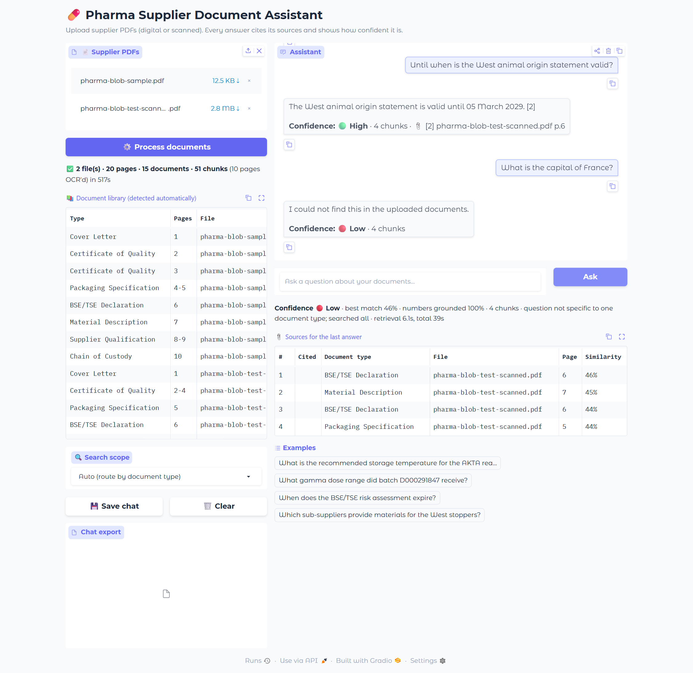

# Pharma Supplier Document Assistant

A fully open-source **retrieval-augmented generation (RAG)** assistant for pharmaceutical supplier documentation. Upload supplier PDFs, digital or scanned, and ask questions in plain English. Every answer cites the file and page it came from and comes with a confidence level.

Built during the **Pfizer AI-Powered Document Insights & Data Extraction externship** with [Extern](https://www.extern.com/) (Aug–Nov 2026).



## What it does

| Stage | How |
|---|---|
| **Read** | PyMuPDF for digital pages. Scanned pages are deskewed and read with **EasyOCR**; table rows are rebuilt from the OCR box positions, and OCR confusions inside IDs are fixed (DO00291847 → D000291847). |
| **Tag** | **Mistral-7B** labels every page (output constrained to a JSON schema), and rules split each bundle into documents: `doc_type`, `doc_id`, `page_range`, `identifier`. |
| **Index** | `BAAI/bge-small-en-v1.5` embeddings in a **LlamaIndex** vector index; 256-token chunks split at line breaks, so table rows are never cut in half. |
| **Route** | The question is classified into a document type and the search is filtered on it (top 4 chunks), with an exact-ID lookup and a weak-match fallback. |
| **Answer** | Mistral-7B-Instruct (4-bit GGUF, llama.cpp) answers from numbered sources, citing `[n]` after each fact, or says it could not find the answer. |
| **Check** | Confidence (High / Medium / Low) from the best-match similarity and whether every number in the answer appears in the sources. |
| **UI** | **Gradio**: multi-PDF upload, automatic document library, search scope, streamed answers, sources table, chat export. |

No paid API is needed: everything runs locally, so documents never leave the machine.

## Results

Evaluated on 10 questions with known answers across a digital supplier bundle and a scanned one (20 pages), including one out-of-scope question. Run on a laptop CPU.

| Metric | With routing | Searching all documents |
|---|---|---|
| Recall@4 | 94.4% | 83.3% |
| MRR | 0.89 | 0.72 |
| Precision@4 | 50.0% | 41.7% |
| Hit rate | 100% | 88.9% |

| End to end | Result |
|---|---|
| OCR word recall on scanned pages | 99.5% |
| Pages given the right document type | 20 / 20 |
| Answers fully correct (strict grading) | 7 / 10 |
| Answers citing a correct page | 8 / 9 |
| Average time per answer (CPU) | 33 s |

The three wrong answers all came from the right page: Mistral-7B once read the wrong line of a table, and twice gave an incomplete answer. The confidence check catches "could not find" answers but not incomplete ones. Full per-question results are in [`results/eval_results.json`](results/eval_results.json).

## Run it

**Colab (recommended, T4 GPU):** open [`notebooks/Full_RAG_Pipeline_UI.ipynb`](notebooks/Full_RAG_Pipeline_UI.ipynb), set *Runtime → Change runtime type → T4 GPU*, and run all cells. The last cell prints a public link to the app.

**Locally:**

```bash
pip install -r requirements.txt
cd app
python app.py
```

Then open http://127.0.0.1:7860. The Mistral model (~4.4 GB) is downloaded on first use; set `MISTRAL_GGUF` to a local path to choose where it is stored. On a CPU, processing takes about 25 s per page the first time (OCR plus classification), and the results are cached, so the same files load in seconds afterwards. Answers take about 30 s on CPU.

**Evaluation:** `python app/evaluate.py <digital.pdf> <scanned.pdf> <original-of-scanned.pdf> results.json`

## Repository layout

```
app/                 the capstone pipeline (rag_core.py), Gradio UI (app.py) and evaluation (evaluate.py)
notebooks/           the capstone as a self-contained Colab notebook
results/             evaluation results
docs/                final presentation and UI screenshots
projects/            the earlier externship projects, in order:
  01-ocr-extraction/                   OCR engine comparison (Tesseract vs EasyOCR) and field extraction
  02-rag-foundations/                  first RAG pipeline with LlamaIndex and Gemini
  03-rag-optimization/                 embedding models, retriever tuning, Gemini vs Mistral / Phi-2 / TinyLlama
  04-document-segmentation-and-routing/  page classification, metadata tagging, query routing
  05-gradio-chatbots/                  first Gradio apps and the document Q&A chatbot
```

## Sample documents

The course's sample supplier documents (bundles of certificates of quality, BSE/TSE declarations and specifications) belong to their publishers and Extern, and are **not included** in this repository. The Colab notebook downloads the two sample bundles from the course's public links. You can use any supplier PDFs of your own.

## Acknowledgements

Externship program by [Extern](https://www.extern.com/) in partnership with Pfizer. Built with Mistral-7B-Instruct, BAAI BGE, EasyOCR, PyMuPDF, LlamaIndex, llama.cpp and Gradio.
